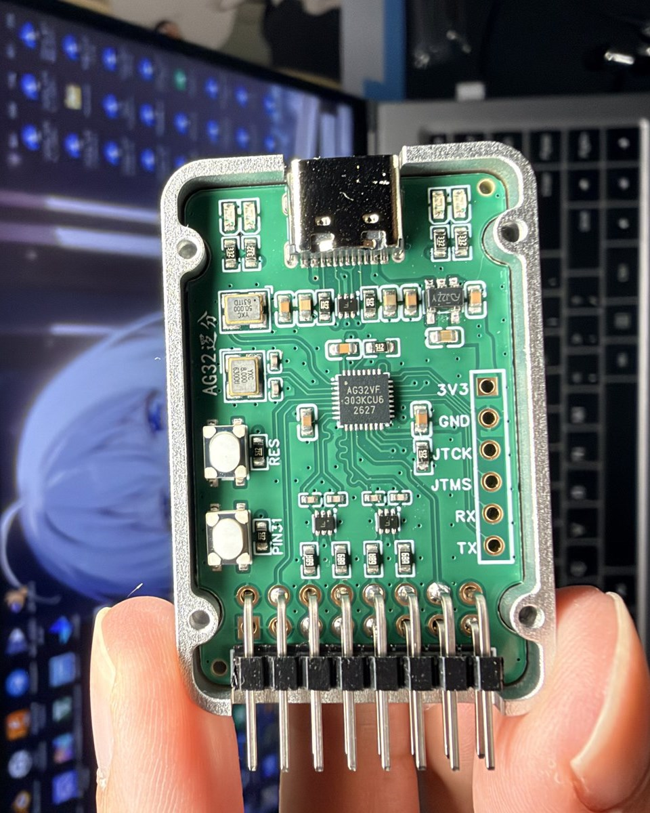
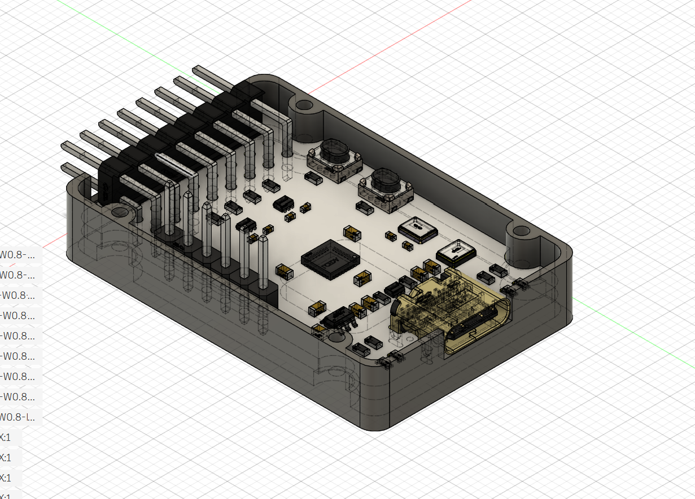
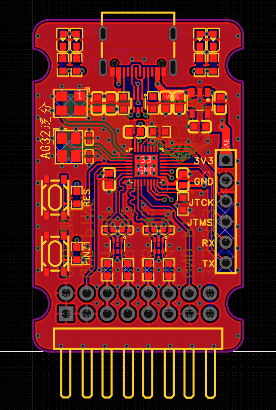
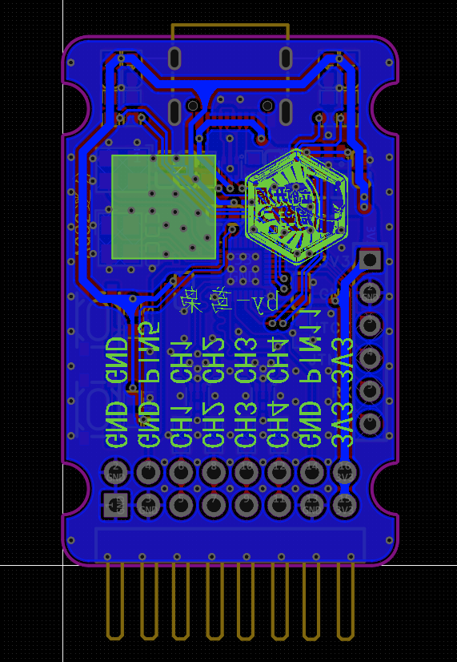
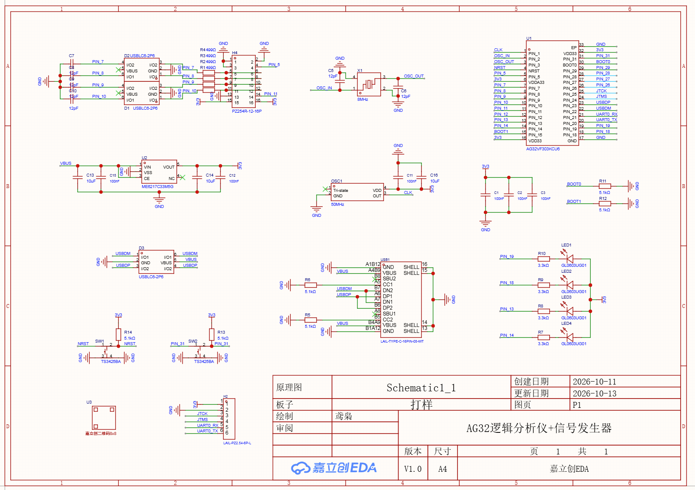
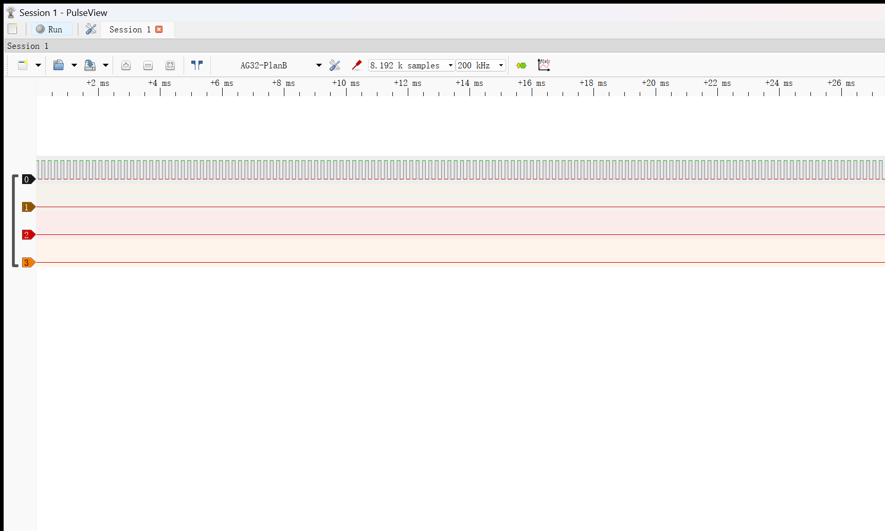

# AG32VF303 四通道逻辑分析仪

用 AG32VF303 内部的 CPLD 做 4 路硬件同步采样，MCU 负责 SUMP/OLS 协议和 USB CDC。设备接入电脑后可以直接用 PulseView 打开，不需要专用上位机或驱动。

板子上另外带一路数字方波/脉冲输出和一路 DAC 波形输出，调试采样器、做触发测试或者给外部电路提供测试信号都比较方便。

<p align="center">
  
</p>

<p align="center"><sub>AG32VF303 QFN32 主控，4 路输入、数字输出、DAC 输出和 USB-C 集成在一块板上。</sub></p>

## 主要参数

| 项目 | 参数 |
|---|---|
| 采样通道 | 4 路数字输入 |
| 最高采样率 | `100 MSa/s` |
| 时间分辨率 | `10 ns` |
| 硬件采样深度 | `8192` 点 |
| 输入引脚 | `PIN_7`、`PIN_8`、`PIN_9`、`PIN_10` |
| 通信接口 | USB 2.0 Full-Speed CDC |
| 上位机协议 | SUMP / OLS |
| 数字输出 | `PIN_5`，方波或触发/脉冲引擎 |
| 模拟输出 | `PIN_11`，DAC0 正弦/方波/锯齿/三角波 |
| 自动化接口 | `mcp/` 中的 MCP server |

采样率计算公式为 `100 MHz / (div + 1)`。分频器为 16 位，最高档是 100 MSa/s，最低可以到约 1.5 kSa/s。

## 当前实测

2026-10-21 使用固件 `v1.1` 在实物板上完成了一轮回归：

| 测试 | 结果 |
|---|---|
| 8 档采样时基 | 全部通过 |
| 50 MHz 回环，100 MSa/s | 稳定后连续 100/100 帧通过 |
| 33.333 MHz 回环 | 20/20 帧通过 |
| 25 MHz 回环 | 20/20 帧通过 |
| 8192 点满深连续捕获 | 200/200 帧，0 丢帧 |
| 纯 USB CDC 吞吐 | 约 `1.00–1.03 MB/s` |
| 满深上传 | 8192 点约 `7.97 ms` |

50 MHz 在 100 MSa/s 下只有 2 个采样点/周期，已经接近奈奎斯特极限。切换 PIN_5 频率后要等待约 50 ms，再启动捕获。

详细数据见 [最近一次测试报告](TEST_REPORT_2026-10-21_PIN5_CH1.md) 和 [性能报告](PERFORMANCE_REPORT.md)。

## 硬件连接

| 功能 | 引脚 | 说明 |
|---|---:|---|
| CH1 / bit0 | `PIN_7` | 数字输入，弱下拉 |
| CH2 / bit1 | `PIN_8` | 数字输入，弱下拉 |
| CH3 / bit2 | `PIN_9` | 数字输入，弱下拉 |
| CH4 / bit3 | `PIN_10` | 数字输入，弱下拉 |
| 数字输出 | `PIN_5` | 方波或触发/脉冲引擎 |
| DAC0 | `PIN_11` | 模拟硬核 DAC，固定坐标绑定 |
| USB D- / D+ | `PIN_22` / `PIN_23` | USB Full-Speed |
| UART0 TX / RX | `PIN_20` / `PIN_21` | 调试串口 |
| LED1–LED4 | `PIN_19` / `PIN_18` / `PIN_13` / `PIN_14` | 低电平点亮 |

CPLD 器件必须使用 `AGRV2KQ32`，对应 QFN32 封装。这个型号不能按 LQFP100 的默认器件配置。

## 硬件与结构

外壳分上下两件，PCB 通过四角螺孔固定。下图为 EasyEDA Pro 工程中的装配视图，排针、按键、USB-C 和 PCB 的相对位置可以直接看出来。

<p align="center">
  
</p>

<p align="center"><sub>外壳、PCB、排针和接口装配视图</sub></p>

### PCB

<table>
  <tr>
    <td align="center" width="50%">
      <a href="hardware/images/pcb-front.png"></a><br>
      <sub>正面</sub>
    </td>
    <td align="center" width="50%">
      <a href="hardware/images/pcb-back.png"></a><br>
      <sub>背面</sub>
    </td>
  </tr>
</table>

### 原理图

<p align="center">
  <a href="hardware/images/schematic.png"></a>
</p>

<p align="center"><sub>点击图片查看原始尺寸</sub></p>

### 外壳文件

| 文件 | 格式 | 大小 |
|---|---|---:|
| [顶壳 STEP](hardware/enclosure/top-case.step) | STEP AP214 | 约 60 KB |
| [底壳 STEP](hardware/enclosure/bottom-case.step) | STEP AP214 | 约 90 KB |

两个模型均保留原始几何结构，长度单位为毫米，可用于结构检查、修改或 3D 打印。仓库不附带特定打印机的切片参数，打印前需要根据材料、喷嘴直径和装配间隙检查模型尺寸。

## 快速开始

### 环境

- Windows
- PlatformIO Core
- AgRV PlatformIO SDK `1.8.10`
- RISC-V toolchain、Supra、AGM OpenOCD
- Quartus II `13.0sp1`，只在重建 CPLD 逻辑时需要
- Python 3.10+，用于测试脚本和波形发生器
- Node.js 20+，用于 MCP server

工程路径不要包含中文。

### 只烧录 MCU 固件

```powershell
git clone https://github.com/ling99LL/ag32-logic-analyzer.git
cd ag32-logic-analyzer
pio run -e logic_analyzer -t upload
```

### 重新生成 CPLD 位流

修改 `logic_board.ve` 或 `logic/analog_ip.v` 后，需要重新编译逻辑并烧录：

```powershell
pio run -e logic_analyzer -t prelogic

cd logic
.\run_quartus_steps.bat
.\run_supra.bat
cd ..

pio run -e logic_analyzer -t logic
pio run -e logic_analyzer -t upload
```

Quartus 13 在本机完成工作后可能以 `0xC0000409` 退出，状态要以每一步生成的 summary 报告为准。不要改用 `run_quartus.tcl` 的一键流程。

`analog_ip.v` 里的 DAC keep-guard 和 `run_quartus_steps.bat` 里的 `alta_dac` 检查不要删除，否则 Quartus 可能把 DAC 硬核当成无用逻辑优化掉。

## 连接 PulseView

设备会枚举成一个 USB 串口，例如 `COM33`。PulseView 中选择：

1. 驱动：`Openbench Logic Sniffer & SUMP compatibles (ols)`
2. 接口：`Serial Port`
3. 串口：设备对应的 COM 口
4. 波特率：`115200`
5. 搜索设备，正常应显示 `AG32-PlanB`

<p align="center">
  
</p>

<p align="center"><sub>PulseView 已识别 AG32-PlanB，并完成 8192 点采集</sub></p>

PulseView、MCP server 和波形发生器不能同时打开同一个 COM 口。

## 测试脚本

上板冒烟：

```powershell
python .\tools\smoke_test.py COM33
```

`PIN_5 -> CH1/PIN_7` 数字回环：

```powershell
python .\live_hardware_test.py
```

`PIN_11 -> CH1/PIN_7` DAC 回环：

```powershell
python .\tools\loopback_test.py COM33
```

冒烟测试的项目数会随跳线和当前接线变化。更多环境和排障说明见 [HANDOVER.md](HANDOVER.md)。

## 板载信号源

图形界面：

```powershell
.\tools\run_wavegen.bat
```

可以控制：

- PIN_11 DAC 波形类型、频率、幅度和输出开关
- PIN_5 数字方波频率
- PIN_5 延时、脉冲宽度、有效电平和主机触发

数字方波由 CPLD 产生。DAC 波表由 DMAC 循环搬运，默认采样率上限为 `5 MSa/s`。

## MCP Server

MCP server 只控制已经烧录好的设备，提供连接、采集、触发、测量和信号源设置。它不负责编译、烧录或 JTAG。

```powershell
cd mcp
npm install
npm run build
npm run check
node .\scripts\mcp_selftest.mjs
node .\dist\index.js
```

注册 MCP 时使用本仓库下的 `mcp\dist\index.js`。工具列表和硬件检查步骤见 [mcp/README.md](mcp/README.md)。

## 使用限制

- `100 MSa/s` 下，50 MHz 信号只有 2 点/周期，只能确认数字边沿，不能当作完整波形质量验证。
- PIN_5 可以输出 100 MHz，但逻辑分析仪无法在 100 MSa/s 下恢复 100 MHz 波形。
- 协议解码建议保证每 bit 至少 4 个采样点，因此 100 MSa/s 下建议信号不超过约 25 MHz。
- 采样率是 CPLD 输入采样率，不是模拟带宽，也不代表任意协议都能稳定解码。
- 修改 VE 或 CPLD 逻辑后，必须同时更新逻辑位流和固件状态，不能只烧 MCU 固件。

## 文档

- [HANDOVER.md](HANDOVER.md)：开发环境、烧录流程和排障记录
- [PERFORMANCE_REPORT.md](PERFORMANCE_REPORT.md)：采样、触发和 USB 性能
- [TEST_REPORT_2026-10-21_PIN5_CH1.md](TEST_REPORT_2026-10-21_PIN5_CH1.md)：最近一次上板测试
- [hardware/README.md](hardware/README.md)：实物图、PCB 图和外壳 STEP 索引
- [mcp/README.md](mcp/README.md)：MCP server 使用说明

