# AG32 Logic Studio

### AG32VF303 四通道逻辑分析仪与信号发生器

<p>
  <a href="https://github.com/ling99LL/ag32-logic-analyzer/releases/tag/v0.1.2"></a>
  
  
  
</p>

使用 AG32VF303 内部 CPLD 完成 4 路硬件同步采样，MCU 通过 USB CDC 提供 SUMP/OLS 协议。既可以直接使用 PulseView，也可以使用全新的 **AG32 Logic Studio** 浅色桌面上位机；桌面端与 MCP 共享同一个串口后台，人工看波形时 AI 仍可发起采集和调整输出。

[文件索引](INDEX.md) · [下载安装版](https://github.com/ling99LL/ag32-logic-analyzer/releases/latest) · [桌面端说明](mcp/README.md) · [硬件资料](hardware/README.md)

<p align="center">
  <a href="mcp/docs/images/ag32-logic-studio.png">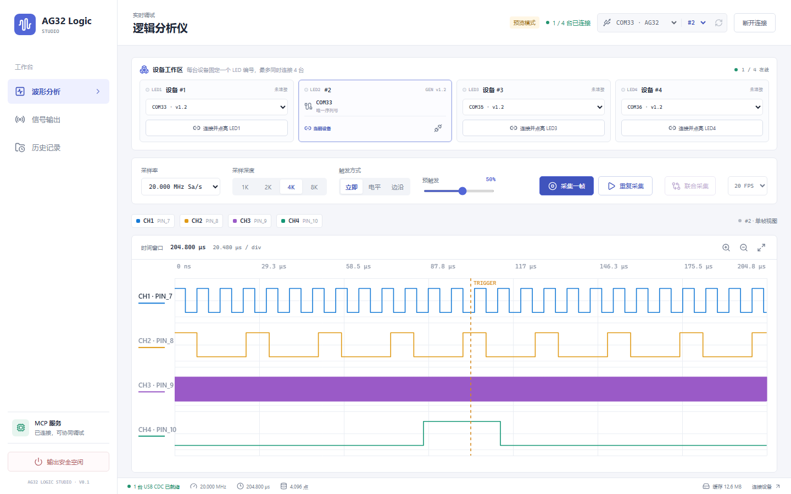</a>
</p>

<p align="center"><sub>AG32 Logic Studio v0.1.2 · 四通道浅色波形工作台、硬件触发与通道测量</sub></p>

## 下载 AG32 Logic Studio v0.1.2

| 版本 | 适用方式 | 文件 |
|---|---|---|
| **EXE 安装包** | 按向导安装，创建桌面与开始菜单快捷方式 | [AG32 Logic Studio-0.1.2-x64-setup.exe](https://github.com/ling99LL/ag32-logic-analyzer/releases/download/v0.1.2/AG32.Logic.Studio-0.1.2-x64-setup.exe) |
| **便携版 ZIP** | 解压后直接运行，不在系统安装 | [AG32 Logic Studio-0.1.2-x64-portable.zip](https://github.com/ling99LL/ag32-logic-analyzer/releases/download/v0.1.2/AG32.Logic.Studio-0.1.2-x64-portable.zip) |

Windows 10/11 x64。安装包暂未签名，首次运行时 Windows SmartScreen 可能要求确认。便携版的数据保存在解压目录下的 `data\`。

## 一个工作台，三条调试路径

**波形分析** 将采样率、深度、预触发和触发设置集中在顶部；下方保留大面积 Canvas 波形、缩放、拖动、时间光标和四通道统计。支持立即触发、电平触发、边沿触发，以及单次采集和可开关的重复采集。

<table>
  <tr>
    <td width="50%" align="center">
      <a href="mcp/docs/images/ag32-logic-studio-outputs.png">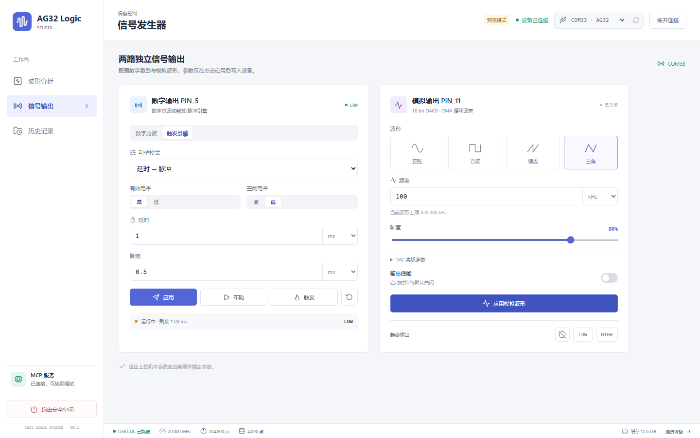</a><br>
      <sub><b>信号输出</b> · PIN_5 数字激励与 PIN_11 DAC 波形独立配置</sub>
    </td>
    <td width="50%" align="center">
      <a href="mcp/docs/images/ag32-logic-studio-history.png">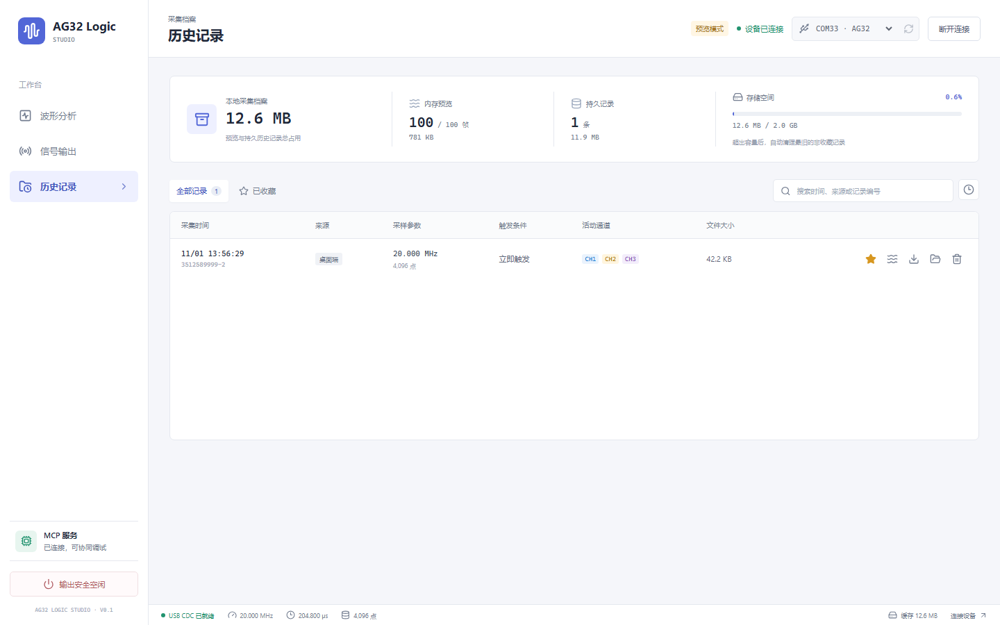</a><br>
      <sub><b>历史档案</b> · 收藏、搜索、VCD 导出和 2 GB 容量管理</sub>
    </td>
  </tr>
</table>

| 能力 | 当前实现 |
|---|---|
| 采样 | `4 CH`、最高 `100 MSa/s`、`10 ns` 时间分辨率、最高 `8192` 点 |
| 触发 | 立即、电平、任意通道上升/下降沿，支持 `0–90%` 预触发 |
| 并发调试 | 桌面端与 MCP 共用 `ag32d`；命令事务优先、MCP 优先、采集帧级让出 |
| 数字输出 | `PIN_5`：1 Hz 至 100 MHz 方波，或延时/主机触发电平与脉冲引擎 |
| 模拟输出 | `PIN_11`：DAC 正弦、方波、锯齿、三角波，以及关闭/静态低/静态高 |
| 历史记录 | 最近 100 帧内存预览；持久记录、收藏、VCD 导出与自动清理 |
| 桌面体验 | 浅色仪器工作台、四页工作流、窄窗口响应式布局与安全空闲 |

> PulseView 需要独占串口，不能与桌面端或 MCP 同时采集。切换工具前先断开当前连接。

<p align="center">
  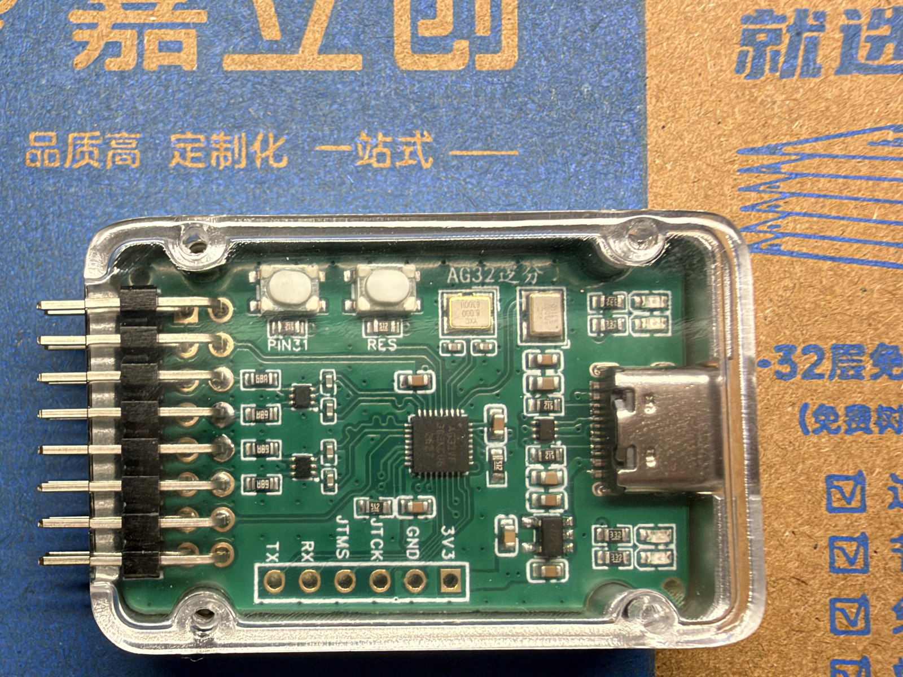
</p>

<p align="center"><sub>AG32VF303 QFN32 主控，4 路输入、数字输出、DAC 输出和 USB-C 集成在一块板上。</sub></p>

## 主要参数

| 项目 | 参数 |
|---|---|
| 采样通道 | 4 路数字输入 |
| 最高采样率 | `100 MSa/s` |
| 时间分辨率 | `10 ns` |
| 硬件采样深度 | `8192` 点 |
| 输入引脚 | `PIN_7`、`PIN_8`、`PIN_9`、`PIN_10` |
| 通信接口 | USB 2.0 Full-Speed CDC |
| 上位机 | AG32 Logic Studio、PulseView / Sigrok |
| 自动化接口 | 共享 `ag32d` 后台与 MCP server |
| 数字输出 | `PIN_5`，方波或触发/脉冲引擎 |
| 模拟输出 | `PIN_11`，DAC0 正弦/方波/锯齿/三角波 |

采样率计算公式为 `100 MHz / (div + 1)`。分频器为 16 位，最高档是 100 MSa/s，最低可以到约 1.5 kSa/s。

## 当前实测

2026-10-21 使用固件 `v1.1` 在实物板上完成了一轮回归：

| 测试 | 结果 |
|---|---|
| 8 档采样时基 | 全部通过 |
| 50 MHz 回环，100 MSa/s | 稳定后连续 100/100 帧通过 |
| 33.333 MHz 回环 | 20/20 帧通过 |
| 25 MHz 回环 | 20/20 帧通过 |
| 8192 点满深连续捕获 | 200/200 帧，0 丢帧 |
| 纯 USB CDC 吞吐 | 约 `1.00–1.03 MB/s` |
| 满深上传 | 8192 点约 `7.97 ms` |

50 MHz 在 100 MSa/s 下只有 2 个采样点/周期，已经接近奈奎斯特极限。切换 PIN_5 频率后要等待约 50 ms，再启动捕获。

详细数据见 [最近一次测试报告](docs/reports/TEST_REPORT_2026-10-21_PIN5_CH1.md) 和 [性能报告](docs/reports/PERFORMANCE_REPORT.md)。

## 硬件连接

| 功能 | 引脚 | 说明 |
|---|---:|---|
| CH1 / bit0 | `PIN_7` | 数字输入，弱下拉 |
| CH2 / bit1 | `PIN_8` | 数字输入，弱下拉 |
| CH3 / bit2 | `PIN_9` | 数字输入，弱下拉 |
| CH4 / bit3 | `PIN_10` | 数字输入，弱下拉 |
| 数字输出 | `PIN_5` | 方波或触发/脉冲引擎 |
| DAC0 | `PIN_11` | 模拟硬核 DAC，固定坐标绑定 |
| USB D- / D+ | `PIN_22` / `PIN_23` | USB Full-Speed |
| UART0 TX / RX | `PIN_20` / `PIN_21` | 调试串口 |
| LED1–LED4 | `PIN_19` / `PIN_18` / `PIN_13` / `PIN_14` | 低电平点亮 |

CPLD 器件必须使用 `AGRV2KQ32`，对应 QFN32 封装。这个型号不能按 LQFP100 的默认器件配置。

## 硬件与结构

外壳分上下两件，透明上盖和底壳把 PCB 包在中间，四角螺孔固定。排针从左侧伸出，USB-C、烧录接口和两颗按键都留在上盖可视区域内，装配后仍能直接检查板卡状态。

### 实物装配

<table>
  <tr>
    <td align="center" width="50%">
      <a href="hardware/images/prototype-board-angle.jpg">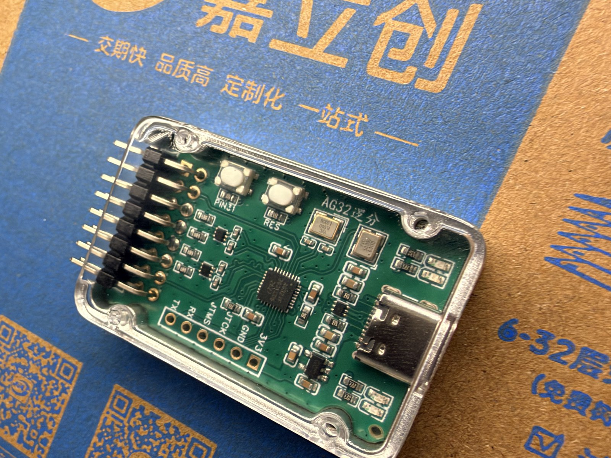</a><br>
      <sub>整机斜视</sub>
    </td>
    <td align="center" width="50%">
      <a href="hardware/images/enclosure-side-view.jpg">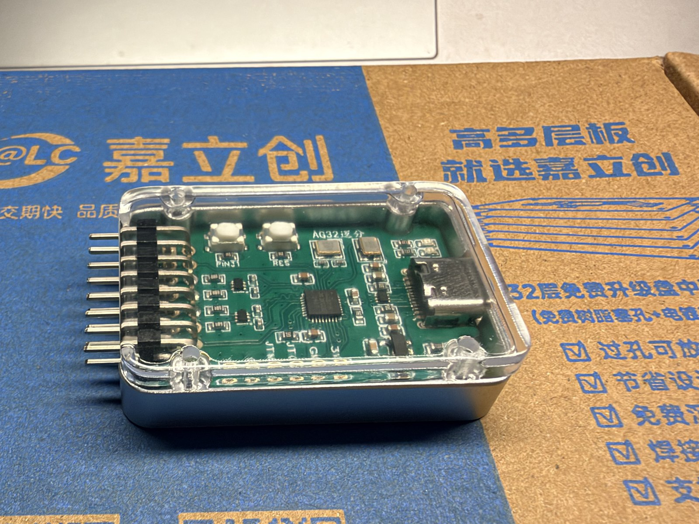</a><br>
      <sub>透明上盖和侧面结构</sub>
    </td>
  </tr>
</table>

<p align="center">
  <a href="hardware/images/enclosure-parts-overview.jpg">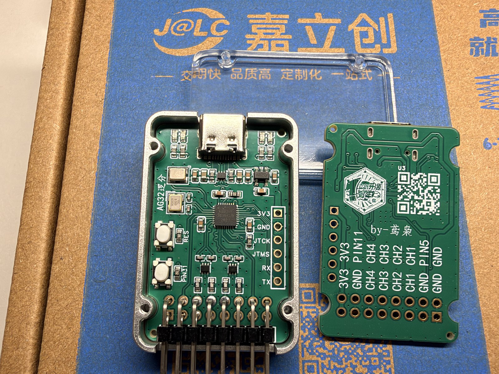</a>
</p>

<p align="center"><sub>透明上盖、装配后的整机和裸板背面</sub></p>

### 结构模型

<p align="center">
  <a href="hardware/images/enclosure-assembly.png">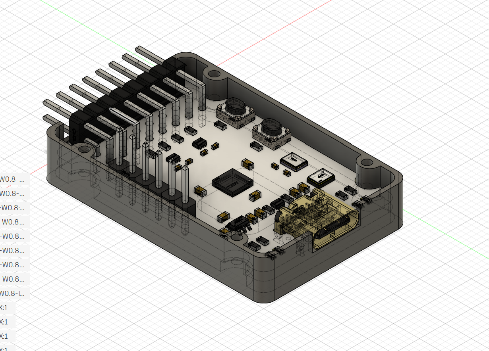</a>
</p>

<p align="center"><sub>EasyEDA Pro 工程中的外壳、PCB、排针和接口装配视图</sub></p>

### PCB

<table>
  <tr>
    <td align="center" width="50%">
      <a href="hardware/images/pcb-front.png">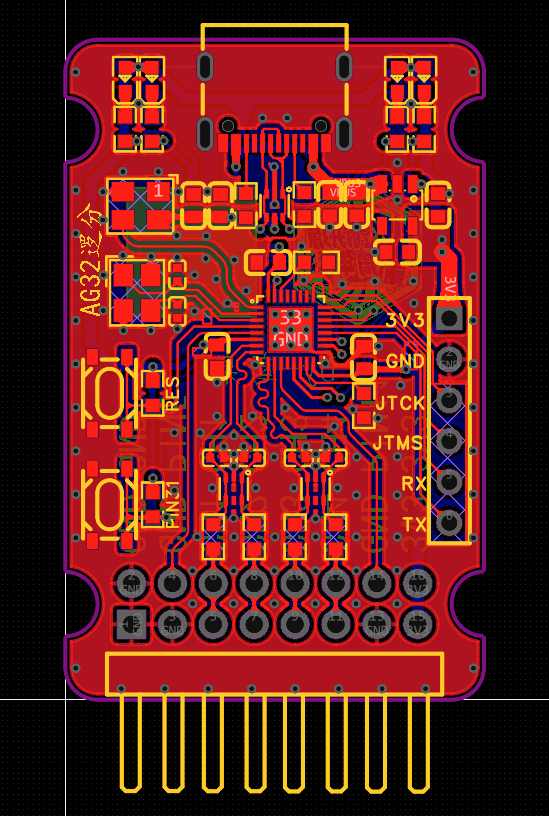</a><br>
      <sub>正面</sub>
    </td>
    <td align="center" width="50%">
      <a href="hardware/images/pcb-back.png">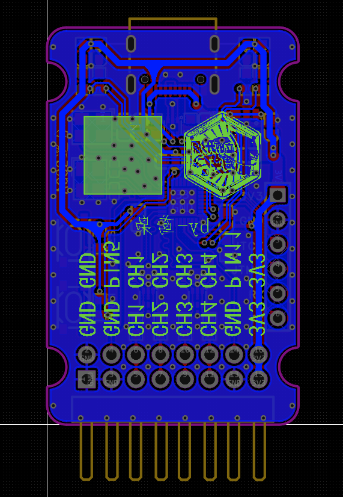</a><br>
      <sub>背面</sub>
    </td>
  </tr>
</table>

### 原理图

<p align="center">
  <a href="hardware/images/schematic.png">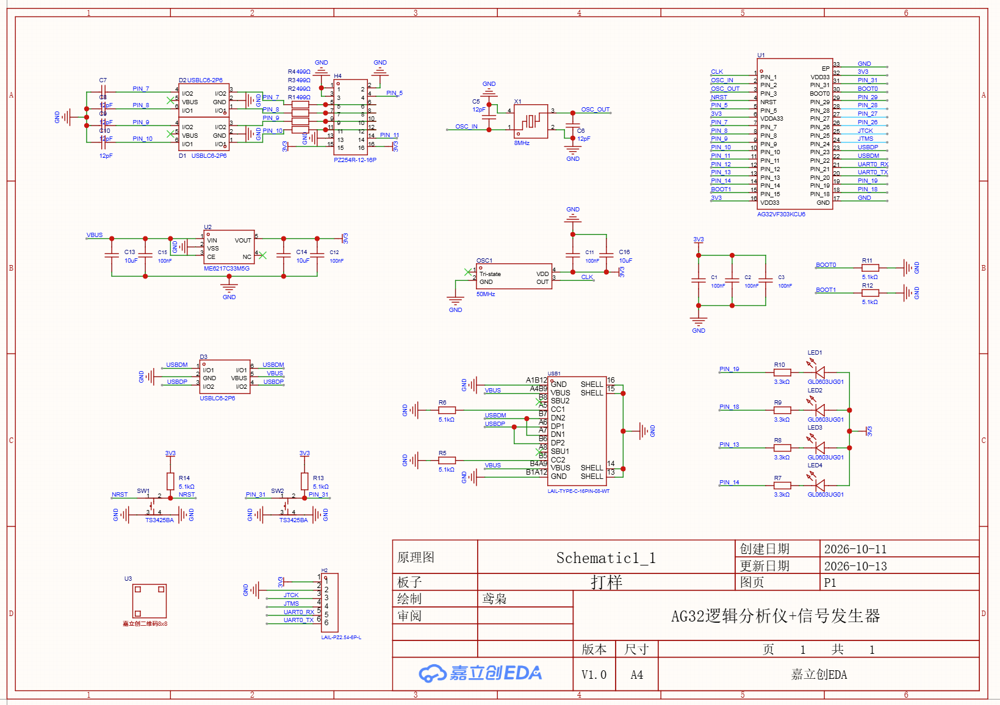</a>
</p>

<p align="center"><sub>点击图片查看原始尺寸</sub></p>

### 外壳文件

| 文件 | 格式 | 大小 |
|---|---|---:|
| [顶壳 STEP](hardware/enclosure/top-case.step) | STEP AP214 | 约 60 KB |
| [底壳 STEP](hardware/enclosure/bottom-case.step) | STEP AP214 | 约 90 KB |

两个模型均保留原始几何结构，长度单位为毫米，可用于结构检查、修改或 3D 打印。仓库不附带特定打印机的切片参数，打印前需要根据材料、喷嘴直径和装配间隙检查模型尺寸。

## 快速开始

### 环境

- Windows
- PlatformIO Core
- AgRV PlatformIO SDK `1.8.10`
- RISC-V toolchain、Supra、AGM OpenOCD
- Quartus II `13.0sp1`，只在重建 CPLD 逻辑时需要
- Python 3.10+，用于测试脚本和波形发生器
- Node.js 20+，用于桌面端、共享后台和 MCP server

工程路径不要包含中文。

### 运行桌面上位机

开发模式：

```powershell
cd mcp
npm install
npm run desktop
```

也可以从 [最新 Release](https://github.com/ling99LL/ag32-logic-analyzer/releases/latest) 下载 Windows 安装包或便携 ZIP。桌面端与 MCP 共用本机 `ag32d`；最后客户端断开后后台空闲 10 秒退出。

### 只烧录 MCU 固件

```powershell
git clone https://github.com/ling99LL/ag32-logic-analyzer.git
cd ag32-logic-analyzer
pio run -e logic_analyzer -t upload
```

### 重新生成 CPLD 位流

修改 `logic_board.ve` 或 `logic/analog_ip.v` 后，需要重新编译逻辑并烧录：

```powershell
pio run -e logic_analyzer -t prelogic

cd logic
.\run_quartus_steps.bat
.\run_supra.bat
cd ..

pio run -e logic_analyzer -t logic
pio run -e logic_analyzer -t upload
```

Quartus 13 在本机完成工作后可能以 `0xC0000409` 退出，状态要以每一步生成的 summary 报告为准。不要改用 `run_quartus.tcl` 的一键流程。

`analog_ip.v` 里的 DAC keep-guard 和 `run_quartus_steps.bat` 里的 `alta_dac` 检查不要删除，否则 Quartus 可能把 DAC 硬核当成无用逻辑优化掉。

### 空片 SWD 烧录

空片状态下 CPLD logic 还没有写入，普通固件 `upload` 不能完成整片初始化。首次上电使用 CMSIS-DAP 的 SWD 两线接口，把 option bytes、CPLD 位流和 MCU 固件作为一个批处理镜像一次写入。

接线：

- DAPLink `SWDIO` 接 AG32 `PIN_24 / JTMS`
- DAPLink `SWCLK` 接 AG32 `PIN_25 / JTCK`
- GND 共地
- `3V3` 接目标板 VDD；DAPLink 供电时确认 J3V 跳线已接通
- `BOOT0 / PIN_30` 保持低电平

烧录：

```powershell
powershell -ExecutionPolicy Bypass -File .\tools\flash_blank_swd.ps1
```

脚本会先运行 PlatformIO 的 `buildbatch`，再通过 CMSIS-DAP SWD 写入完整的 `*_batch.bin`。默认 SWD 时钟为 5 MHz；如果出现 Flash 写超时，可以改用 `-AdapterSpeed 2500`。有多台探针时用 `-AdapterSerial` 指定 DAPLink。

仓库已经包含本次验证过的预编译位流 `logic/logic_board.bin`，所以新 clone 的源码环境不需要 Quartus 和 Supra 就能生成批处理镜像并完成首次烧录。只有修改 `.ve`、`analog_ip.v` 或其他 CPLD 逻辑源码时，才需要重新执行三段式编译并更新这个位流。

当前位流大小 `22,427 B`，SHA-256：`AEAE971EA7A4D6DCC33A3E5252DEF7201A327234517A1AC2D835C70F588A0A00`。

如果空片首次连接无法 halt，可以在 DAPLink `nRESET` 接到 AG32 `PIN_4 / NRST` 后加 `-UseSrst`。

写入完成后脚本会执行 `reset run`。如果复位后没有重新加载 logic 或程序仍不运行，断电重上电一次即可。详细参数和硬件前提写在脚本头部，也可以用 `-DryRun` 只打印命令、不操作芯片。

## 连接 PulseView

设备会枚举成一个 USB 串口，例如 `COM33`。PulseView 中选择：

1. 驱动：`Openbench Logic Sniffer & SUMP compatibles (ols)`
2. 接口：`Serial Port`
3. 串口：设备对应的 COM 口
4. 波特率：`115200`
5. 搜索设备，正常应显示 `AG32-PlanB`

<p align="center">
  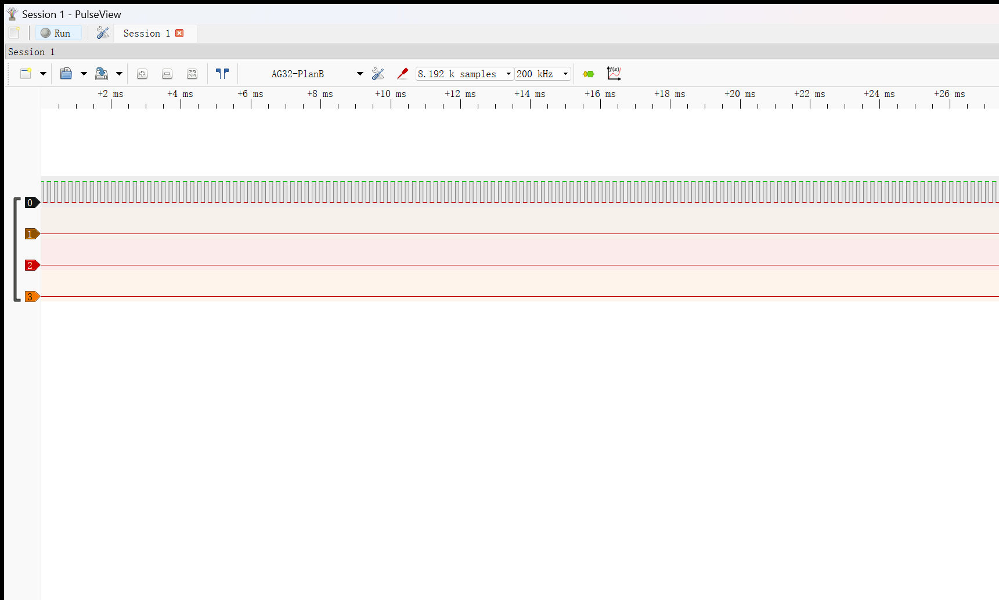
</p>

<p align="center"><sub>PulseView 已识别 AG32-PlanB，并完成 8192 点采集</sub></p>

PulseView 必须以独占方式打开设备，不能与 AG32 Logic Studio 或 MCP 同时采集。桌面端和 MCP 之间则通过同一个 `ag32d` 后台共享串口，可以同时调试。

## 测试脚本

上板冒烟：

```powershell
python .\tools\smoke_test.py COM33
```

`PIN_5 -> CH1/PIN_7` 数字回环：

```powershell
python .\tools\host\live_hardware_test.py
```

`PIN_11 -> CH1/PIN_7` DAC 回环：

```powershell
python .\tools\loopback_test.py COM33
```

冒烟测试的项目数会随跳线和当前接线变化。更多环境和排障说明见 [docs/HANDOVER.md](docs/HANDOVER.md)。

## 板载信号源

图形界面：

```powershell
.\tools\run_wavegen.bat
```

可以控制：

- PIN_11 DAC 波形类型、频率、幅度和输出开关
- PIN_5 数字方波频率
- PIN_5 延时、脉冲宽度、有效电平和主机触发

数字方波由 CPLD 产生。DAC 波表由 DMAC 循环搬运，默认采样率上限为 `5 MSa/s`。

## 桌面端与 MCP

桌面端和 MCP 都只控制已经烧录好的设备。它们共用本机命名管道、命令事务队列、帧级采集让出、预览缓存和持久历史；不负责编译、烧录或 JTAG。

```powershell
cd mcp
npm install
npm run build
npm run check
node .\scripts\mcp_selftest.mjs
node .\dist\index.js
```

MCP 保留原有工具名、参数和主要返回语义，并新增安全空闲、最近采集读取、PIN_5 单步控制和 PIN_11 静态输出。注册 MCP 时使用本仓库下的 `mcp\dist\index.js`，完整工具列表、桌面端架构和硬件检查步骤见 [mcp/README.md](mcp/README.md)。

## 使用限制

- `100 MSa/s` 下，50 MHz 信号只有 2 点/周期，只能确认数字边沿，不能当作完整波形质量验证。
- PIN_5 可以输出 100 MHz，但逻辑分析仪无法在 100 MSa/s 下恢复 100 MHz 波形。
- 协议解码建议保证每 bit 至少 4 个采样点，因此 100 MSa/s 下建议信号不超过约 25 MHz。
- 采样率是 CPLD 输入采样率，不是模拟带宽，也不代表任意协议都能稳定解码。
- 修改 VE 或 CPLD 逻辑后，必须同时更新逻辑位流和固件状态，不能只烧 MCU 固件。

## 文档

- [docs/HANDOVER.md](docs/HANDOVER.md)：开发环境、烧录流程和排障记录
- [docs/reports/PERFORMANCE_REPORT.md](docs/reports/PERFORMANCE_REPORT.md)：采样、触发和 USB 性能
- [docs/reports/TEST_REPORT_2026-10-21_PIN5_CH1.md](docs/reports/TEST_REPORT_2026-10-21_PIN5_CH1.md)：最近一次上板测试
- [docs/README.md](docs/README.md)：报告、截图和背景文档导航
- [INDEX.md](INDEX.md)：整个项目的文件索引与分类说明
- [hardware/README.md](hardware/README.md)：实物图、PCB 图和外壳 STEP 索引
- [mcp/README.md](mcp/README.md)：桌面端、共享后台和 MCP 使用说明

