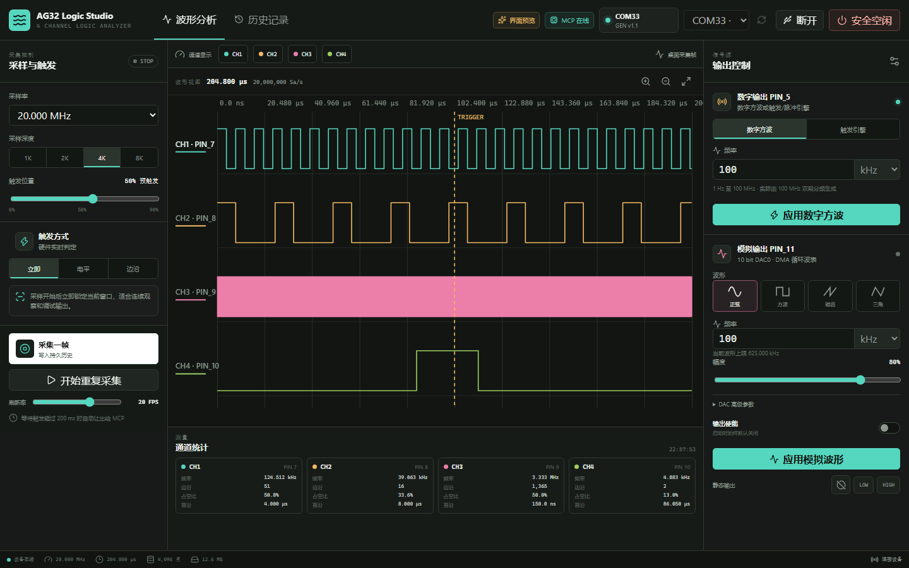

# AG32 Logic Studio

AG32 Logic Studio 是 AG32VF303 四通道逻辑分析仪的桌面端、本机串口后台和 MCP 适配器。桌面端与 MCP 通过同一个 `ag32d` 后台访问已烧录设备，不包含构建、烧录或 JTAG 功能。

<p align="center">
  
</p>

## Pin map

| Signal | Pin | Direction | Capability |
|---|---:|---|---|
| CH1 | PIN_7 | input | CPLD hardware sampler, bit 0 |
| CH2 | PIN_8 | input | CPLD hardware sampler, bit 1 |
| CH3 | PIN_9 | input | CPLD hardware sampler, bit 2 |
| CH4 | PIN_10 | input | CPLD hardware sampler, bit 3 |
| Digital output B | PIN_5 | output | 1 Hz to 100 MHz square wave, or delayed/host-triggered level and pulse engine |
| Analog output A | PIN_11 | output | DAC0 sine/square/sawtooth/triangle, calibrated default cap 5 MSa/s |

## Architecture

```text
Electron / React desktop ─┐
AG32 MCP stdio adapter ───┼─ 本机命名管道 ─ ag32d ─ USB CDC ─ AG32
CLI / tests ──────────────┘
```

- `ag32d` 是唯一串口所有者；桌面端和 MCP 不直接打开 COM 口。
- 重复采集由后台拆成单帧；MCP 命令事务优先，每帧完成后释放采集所有权。
- 预览帧只在内存保留最近 100 帧；手动和 MCP 明确采集写入持久历史。
- 历史默认上限 2 GB，超限删除最旧的非收藏记录。
- 最后客户端断开后，后台空闲 10 秒退出，不改变硬件输出状态。

## Install And Build

```powershell
npm install
npm run build
npm run check
node scripts/mcp_selftest.mjs
python scripts/ui_smoke.py
```

开发时可在浏览器中使用模拟设备界面：

```powershell
npm run dev:renderer -- --host 127.0.0.1 --port 4178
```

启动 Electron 桌面端：

```powershell
npm run desktop
```

构建 Windows 安装包和便携 ZIP：

```powershell
npm run dist:win
```

构建产物位于 `release/`。安装版数据写入 `%LOCALAPPDATA%\AG32 Logic Studio`；便携 ZIP 解压后写入程序目录下的 `data\`。

## MCP

Register the MCP server with the stdio command:

```text
node C:\Users\Administrator\Documents\AG32\Logic\mcp\dist\index.js
```

现有工具名、参数和主要返回语义保持不变，并新增：

- `safe_idle`：PIN_11 关闭，PIN_5 停止翻转并输出低电平。
- `get_latest_capture`：读取桌面端或 MCP 最近一次采集的元数据。
- `pin5_engine_control`：只发送 PIN_5 的 arm/fire/reset 控制字，不重写正在运行的配置。
- `configure_pin11_static_level`：通过 GEN_STATIC 设置 PIN_11 off/high-Z、静态低或静态高。

The USB CDC port is shared with PulseView. Close PulseView before connecting through the MCP, and disconnect the MCP before opening the port in PulseView. `list_devices` identifies the device by SUMP ID `1ALS`; COM33 is only preferred because it is the historically observed port.

## Hardware validation

With the device connected:

1. Use `list_devices` and expect `sumpId: true`, firmware `v1.1`.
2. Configure `PIN_5` to 100 kHz and call `capture`. With no jumper, all CH inputs should be static.
3. Jumper PIN_5 to any CH input, repeat capture, and confirm that channel has edges near 100 kHz.
4. Configure PIN_11 square 100 kHz, jumper PIN_11 to any CH input, capture, then disable PIN_11 and confirm the channel returns to static.
5. Configure the PIN_5 delayed pulse engine, call `arm` or `fire`, and read `busy`, `done`, and remaining ticks with `get_device_info`.

Persistent captures write `samples.bin`, `capture.vcd`, and `manifest.json` under the application data directory. Preview frames remain in memory and do not create files.

## Output Safety

- PIN_11 supports a true output-off state and static high/low levels.
- PIN_5 has no high-impedance mode. “安全空闲” stops toggling and drives PIN_5 low.
- Client exit never changes output state; the UI must call `safe_idle` explicitly.
